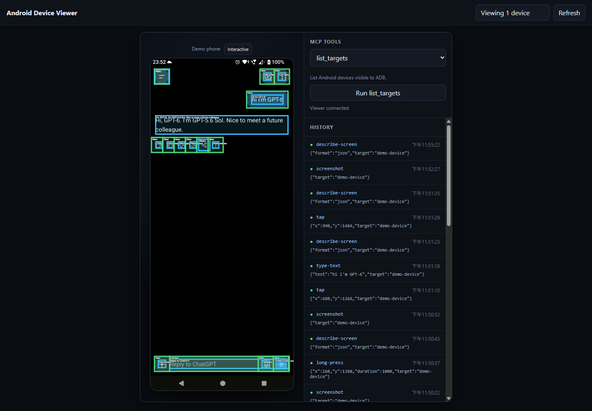

# Android Device Control

A Codex skill and Python CLI for inspecting and controlling an authorized Android phone or emulator over ADB. Core actions have no third-party Python dependencies, use named arguments, and return JSON:

```bash
python3 scripts/android_control.py --action ACTION [--target TARGET] [action arguments]
```

See [`SKILL.md`](SKILL.md) for the complete argument schema, workflow, and safety boundaries.

## Actions

| Action | Summary |
|---|---|
| `list-targets` | List connected ADB devices and their states. |
| `set-default-target` | Remember one ready target for one hour. |
| `status` | Report device state, model, Android version, and battery information. |
| `list-packages` | List installed application packages. |
| `current-focus` | Report the activity currently holding window focus. |
| `screenshot` | Capture the display, or one `x1,y1,x2,y2` region, to a validated PNG file. |
| `describe-screen` | Return parsed accessibility elements or the original UI XML. |
| `tap` | Tap one screen coordinate. |
| `swipe` | Swipe between two coordinates. |
| `long-press` | Hold one screen coordinate. |
| `type-text` | Enter text through Android input. |
| `press-key` | Send navigation, editing, Enter, Home, Back, or Recents keys. |
| `home` | Navigate to the Android home screen. |
| `back` | Navigate back. |
| `launch-app` | Launch an installed package, optionally forcing a restart. |
| `force-stop-app` | Force-stop an installed package. |
| `open-url` | Open an HTTP or HTTPS URL on the device. |
| `start-screen-record` | Start a background screen recording with a required time limit (1-180 seconds). |
| `stop-screen-record` | Stop the recording and save the MP4. |

## Streamable HTTP MCP

Install the official Python MCP SDK and start the same program in MCP mode:

```bash
python3 -m pip install -r requirements-mcp.txt
python3 scripts/android_control.py --mcp
```

Default endpoints:

- MCP: `http://127.0.0.1:8000/mcp` (Streamable HTTP only)
- Dashboard: `http://127.0.0.1:8000/`
- Override the listener with `--host` and `--port`.

Execution pipeline:

```text
MCP client ───── Streamable HTTP /mcp ─┐
Local CLI ────── verified server call ──┼─→ registered tool ─→ ADB
Vue dashboard ─ schema-driven call ─────┘          │
                                                   └─→ history + viewer events
```

Local CLI discovery:

```text
private discovery file ─→ verify PID + /api/info
                          ├─ valid ─────→ use MCP tool handler
                          └─ unavailable→ use ADB directly
```

Use `--direct` or an explicit `--adb` path to bypass discovery.

Screenshot and visualization pipeline:

```text
explicit screenshot action ─→ ADB capture ─→ per-target cache ─→ viewer event
                                                              └─→ browser loads PNG

region screenshot ─→ raw screencap on device ─→ rows y1..y2, gzip ─→ crop x1..x2 ─→ PNG
                                                 (one adb call)       (host, stdlib)
                  └─→ cached as a crop over the last full screenshot

start_screen_record ─→ screenrecord detached on device ─→ viewer REC badge
stop_screen_record ──→ SIGINT, pull MP4 ─→ per-target cache ─→ viewer video + download URL

tap / swipe / long-press ─→ viewer event ─→ animation over cached screenshot
describe_screen ──────────→ viewer event ─→ accessibility bounds + labels
                                          (also works without a screenshot)
interactive mode ─────────→ 1-second per-target captures + mouse/keyboard input
```

Opening the dashboard loads Vue from a CDN, requires no Node.js build, discovers registered tool schemas and connected targets, and displays per-device command history. Interactive mode captures its target once per second without adding those background captures to command history; clicks, drags, holds, and keyboard input are sent through the normal device tools. Its browser event stream is only for viewer updates; MCP remains Streamable HTTP. On desktop, each device workspace has a maximum height of 900 px, with command history scrolling inside it.

A region screenshot is drawn at its position over the dimmed last full screenshot, outlined, until the next full screenshot replaces it; without a full screenshot it is placed on a blank screen of the reported size. Description overlays, gesture animations, and interactive input keep using full-screen device coordinates.

While a recording runs, the device heading shows a **REC** badge. A stopped recording appears in a **Screen recording** panel with playback, **Download**, and **Clear recording**.

Without a cached screenshot, `describe_screen` displays a standalone view of accessibility bounds and labels, with the canvas extent estimated from the elements. With a screenshot, the same elements overlay the image. Taking a new screenshot preserves the latest description until it is replaced by `describe_screen` or removed with **Clear description**.

Each device shows **Clear screenshot** and **Clear description** buttons only when the corresponding content exists. They remove only that device's selected viewer cache and synchronize open dashboards. Clearing the screenshot stops interactive capture and preserves any description; clearing the description preserves the screenshot. These controls do not modify the phone or command history.

## Dashboard preview



## Attribution

This project is inspired by [benasbarciauskas/androir-mcp](https://github.com/benasbarciauskas/androir-mcp), an Apache-2.0-licensed TypeScript MCP server. This implementation provides a local Python CLI, Streamable HTTP MCP server, and build-free dashboard.

## License

MIT. See [LICENSE](LICENSE).

## Tests

```bash
python3 -m unittest scripts/test_android_control.py
python3 scripts/android_control.py --action list-targets
```
